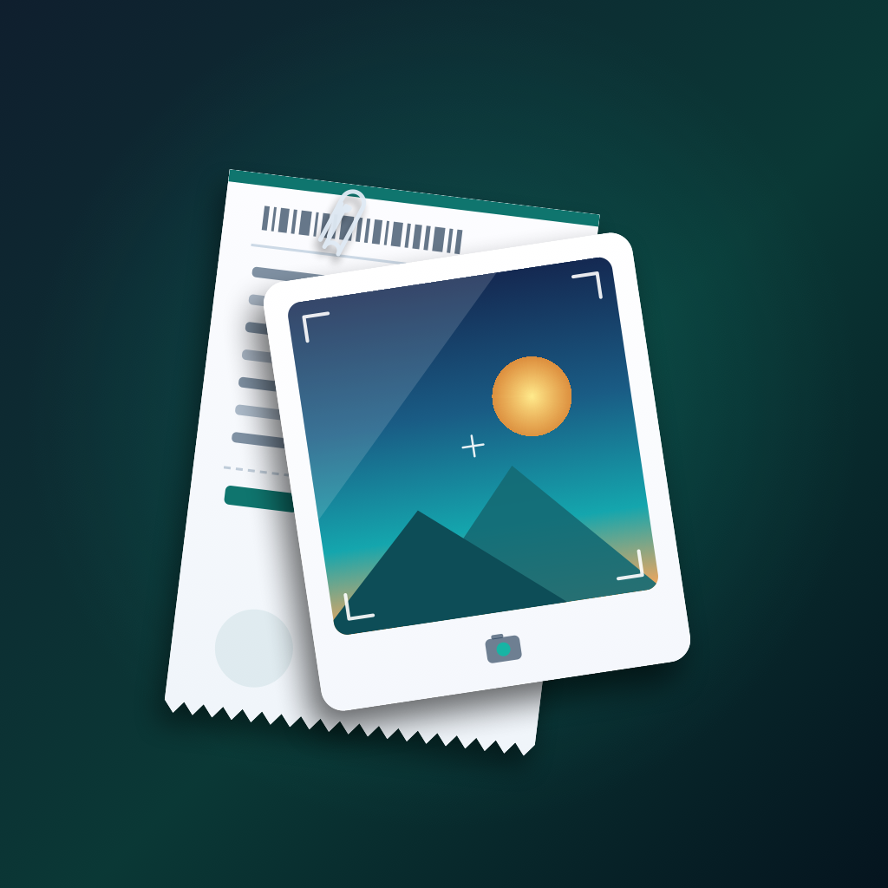

# Receipt Record

<p align="center">
  
</p>

<p align="center">
  <strong>Smart receipt tracking, scanning, and expense analytics application built with Flutter.</strong>
</p>

---

## 📌 Overview

**Receipt Record** is a cross-platform Flutter application designed to make tracking expenses and managing receipts effortless. Snap a photo of any receipt, automatically extract line items and amounts with on-device OCR, categorize expenses, and visualize spending patterns through rich interactive summaries and charts.

- **Application Name:** Receipt Record
- **Application ID / Namespace:** `self.ricky.receipt_record`
- **Supported Platforms:** iOS, Android, macOS, Web, Linux, Windows

---

## ✨ Features

- 📸 **Receipt Scanning & OCR:** Capture receipts via camera or import photos from the device library. Text recognition automatically extracts the merchant name, transaction date, line items, and total amount.
- 🧾 **Itemized Expense Management:** Track individual items, quantities, and unit prices. Subtotals, tax, and totals are computed and synchronized in real time.
- 🏷️ **Smart Categorization:** Organize expenses across standard categories (groceries, dining, transportation, utilities, shopping, entertainment, healthcare, and more) with custom color badges.
- 📊 **Visual Analytics & Summaries:**
  - Category breakdown with interactive distribution charts (`fl_chart`).
  - Monthly spending trends.
  - Quick-glance metric cards (Total Spent, Receipt Count, Average Expense, Top Category).
- 📤 **Export Capabilities:** Export your receipt archives and expense summaries to CSV spreadsheets and share them seamlessly.
- 🌓 **Dark & Light Mode Support:** Fluid theme toggling built with a custom Material 3 teal palette (`#0F766E`).
- 🔒 **Offline-First & Privacy-Focused:** All receipt data and photos remain stored locally on your device.

---

## 🏗️ Architecture & Project Structure

```text
receipt_record/
├── assets/
│   └── icons/                 # High-resolution application icon assets
├── lib/
│   ├── models/                # Domain models (Receipt, ReceiptItem, ReceiptCategory, SummaryData)
│   ├── screens/               # App UI screens
│   │   ├── home_navigation_screen.dart
│   │   ├── receipt_list_screen.dart
│   │   ├── receipt_detail_screen.dart
│   │   ├── add_edit_receipt_screen.dart
│   │   ├── summary_screen.dart
│   │   └── export_screen.dart
│   ├── services/              # Core business services
│   │   ├── storage_service.dart      # Local persistent storage
│   │   ├── ocr_service.dart          # ML Kit text recognition
│   │   ├── receipt_parser.dart       # Smart regex & semantic receipt parser
│   │   ├── export_service.dart       # CSV generation
│   │   └── sample_data_service.dart  # Mock datasets for quick testing
│   ├── theme/                 # AppTheme & color schemes
│   ├── utils/                 # Currency & date formatting helpers
│   ├── widgets/               # Reusable UI components & custom charts
│   └── main.dart              # Application entry point
├── android/                   # Android native project (namespace: self.ricky.receipt_record)
├── ios/                       # iOS native project (bundle ID: self.ricky.receiptRecord)
├── macos/                     # macOS native project
├── web/                       # Web entry point & PWA manifests
└── test/                      # Unit & widget test suites
```

---

## 🚀 Getting Started

### Prerequisites

- [Flutter SDK](https://docs.flutter.dev/get-started/install) (`^3.13.5` or later)
- [Dart SDK](https://dart.dev/get-dart)
- Xcode (for iOS/macOS development) or Android Studio (for Android development)

### Installation

1. **Clone the repository:**
   ```bash
   git clone https://github.com/rickyli/receipt-record.git
   cd receipt-record
   ```

2. **Install Flutter dependencies:**
   ```bash
   flutter pub get
   ```

3. **Run the application:**
   ```bash
   flutter run
   ```

4. **Run test suites:**
   ```bash
   flutter test
   ```

---

## 📝 License

Copyright © 2026 self.ricky. All rights reserved.
